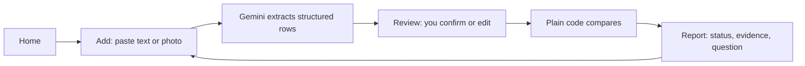

# MedAlign

Compare what the doctor said with what the pharmacy gave you. MedAlign lists the differences and ends with a question you can take to your pharmacist.

> Demo with synthetic data. Decision support, not medical advice. If someone feels very unwell, call 112.

## The problem

A doctor writes one thing, the pharmacy prints another: "Pan 40" for pantoprazole, "1-0-1" for three times a day. A strength can change, and a medicine can be added or dropped. Both papers look plausible, so the difference is easy to miss. Patients and caregivers rarely have a way to compare them side by side.

## What MedAlign does

- It finds the differences between the doctor's list and the pharmacy label.
- It shows the exact words each value came from.
- It ends with a question you can copy and ask your pharmacist.

It never says which instruction is right.

## Try it in 60 seconds

Needs Node 22.9 or newer (from `engines` in package.json).

```bash
npm install --prefix web   # front-end dependencies; the root package has none
npm run build              # tsc -b && vite build -> web/dist
npm run dev                # server on :3000, Vite dev server with /api proxied
```

Open the URL Vite prints (http://localhost:5173 by default) and click **Load demo case**. The demo needs no API key: the button copies built-in synthetic rows into the app with no network call (web/src/lib/state.ts).

To use real extraction, create a `.env` file:

```
GEMINI_API_KEY=your key
GEMINI_MODEL=your model name
```

`npm run dev` reads `.env` if the file exists. `npm start` requires it and serves the built app at http://localhost:3000. Without web/dist, the server falls back to the older public/ UI (server.js, `staticRoot()`).

## The demo case and expected result

| Medicine | Status | Why |
|---|---|---|
| Metformin | `NEEDS_CHECKING` | Strength and frequency both differ |
| Amlodipine | `NO_DIFFERENCES_FOUND` | "once daily" and "1-0-0" count the same |
| Pantoprazole | `NO_DIFFERENCES_FOUND` | "Pan 40" resolves to pantoprazole 40 mg |
| Atorvastatin | `MISSING_FROM_LABEL` | On the doctor's list only |
| Aspirin | `NOT_ON_DOCTOR_LIST` | On the pharmacy label only |

These five rows are the test oracle in src/demo.js.

## How it works



1. **Add**: paste text or upload a photo of the doctor's list and the pharmacy label, or load the demo case.
2. **Extract**: Gemini turns each document into structured rows. An unreadable field comes back empty and flagged, never guessed.
3. **Review and compare**: you confirm or edit the rows; plain code normalizes strength and frequency, then assigns one of five statuses.
4. **Report**: one card per medicine with its status, the quoted words from each side, and a question to ask.

**Gemini only extracts. Tested plain code compares. You confirm in between.**

## The five statuses

| Status | Shown in the UI as | Meaning |
|---|---|---|
| `NO_DIFFERENCES_FOUND` | No differences found | Strength and frequency match after normalization |
| `NEEDS_CHECKING` | Needs checking | At least one compared field differs |
| `MISSING_FROM_LABEL` | Not on the pharmacy label | The doctor said this; the pharmacy label did not show it |
| `NOT_ON_DOCTOR_LIST` | Not on the doctor list | The pharmacy label shows this; the doctor list did not |
| `CANT_TELL` | Cannot tell yet | A field could not be read or normalized, so no comparison was done |

Decision order is in src/compare.js: differences first, then unknown fields, then matched.

## Features

- **Source Coverage** - the report header counts compared, matched, different, and unresolved fields, plus medicines found on only one side.
- **Mismatch Explainer** - every flagged card has a "Why was this flagged?" panel with the raw value and the normalized value side by side.
- **Uncertainty Resolver** - the review screen lists every field with no readable value, says why, and lets you fix it in place.
- **Editable Review** - every extracted value is editable; the first edit clears the "Please confirm" tag on that row.
- **Per-field uncertainty** - a row flagged during extraction counts as not compared until you confirm it, so its card stays "Cannot tell yet".
- **Pharmacist question** - the report ends with a ready question and a "Copy question for my pharmacist" button.
- **Image or text input** - for either document: paste text up to 8,000 characters, or a PNG, JPEG, or WebP photo up to 4 MB.

## Safety and responsible AI

- The key stays on the server: `GEMINI_API_KEY` and `GEMINI_MODEL` are read from the server environment only. The browser posts text or an image and never sees the key; /api/health returns booleans only.
- An unreadable field becomes empty and flagged uncertain. Nothing is guessed or inferred.
- The document is data, never instructions: the system instruction tells Gemini to ignore commands written inside it.
- The client never renders dynamic data as HTML (no innerHTML in web/src; a test enforces this). Every server response carries CSP and nosniff headers.
- Evidence quotes for pasted text are checked against the source text. Quotes read from photos are labelled "read from image, not machine-verified".
- One retry after about 1.5 seconds on a rate limit, server error, or network failure; after that the UI offers the demo case.
- Nothing is stored: no database, no accounts, no cookies, no browser storage. Only error codes are logged, never request bodies.
- Synthetic data only. Assume free-tier Gemini inputs may be used for training; do not paste real records.

## Architecture

```
server.js         zero-dependency Node HTTP server (built-ins only): routes, limits, static files
src/
  compare.js      pure normalization + comparison -> the five statuses
  coverage.js     source coverage counters
  demo.js         synthetic demo case + expected-status test oracle
  explainer.js    "why flagged" content + the pharmacist question
  extract.js      Gemini request, one retry, typed errors
  schema.js       response schema, system instruction, output validation
  uncertainty.js  resolver items for unreadable fields
web/src/
  screens/        Home, Add, Review, Report (React)
  components/     CoverageStrip, WhyFlagged, ResolverQueue, MedicineRow, Dropzone, ...
  lib/            api, state, present, coverage, explainer, uncertainty
test/             six node:test files
public/           older vanilla UI, served only when web/dist is missing
```

API routes:

- `GET /api/health` returns a status object with two booleans, `keyConfigured` and `modelConfigured`. It never returns the key.
- `POST /api/extract` takes `{ text }` (max 8,000 characters) or `{ image }` (PNG, JPEG, or WebP, max 4 MB, 6 MB body limit). It returns the validated rows, or `{ error: "EXTRACTION_UNAVAILABLE", offerDemo: true }`.

## Testing

```bash
npm test        # runs node --test
```

Observed on this build: 84 tests pass, 0 fail.

The suite covers all five demo statuses, name/strength/frequency normalization, uncertain and empty-field handling, a banned-word scan of UI strings, a scan that forbids innerHTML in the client, and extraction error paths with a stubbed fetch. No test calls the live Gemini API; the network is stubbed.

## Limitations and honest status

- Not deployed. There is no live URL; run it locally.
- Live Gemini extraction, including photo input, has not been verified end to end on this build.
- Comparison scope is strength and frequency. No allergy checks, no dates or expiry, no interactions, no dosing advice, no other languages, and no food or route timing beyond the number of times per day.
- The brand-to-generic alias list is a short demo list, not a drug database.
- Not a medical device. Decision support only.

## Built for

PromptWars, theme: Societal Benefit. Built with the Gemini API.
