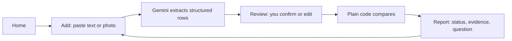

# MedAlign

Compare what the doctor said with what the pharmacy gave you. MedAlign lists the differences and ends with a question you can take to your pharmacist.

> Demo with synthetic data. Decision support, not medical advice. If someone feels very unwell, call 112.

## The problem

A doctor writes one thing, the pharmacy prints another: "Pan 40" for pantoprazole, "1-0-1" for twice daily. A strength can change, and a medicine can be added or dropped. Both papers look plausible, so the difference is easy to miss. Patients and caregivers rarely have a way to compare them side by side.

## What MedAlign does

- It finds the differences between the doctor's list and the pharmacy label.
- It shows the exact words each value came from.
- It ends with a question you can copy and ask your pharmacist.

It never says which instruction is right.

## Try it in 60 seconds

Needs Node.js 22.12 or newer (from `engines` in package.json and the installed
Vite toolchain).

```bash
npm install --prefix web   # front-end dependencies; the root package has none
npm run build              # tsc -b && vite build -> web/dist
npm run dev                # server on :3000, Vite dev server with /api proxied
```

Open the URL Vite prints (http://localhost:5173 by default) and click **Load demo case**. The demo needs no API key: the button copies built-in synthetic rows into the app with no network call (web/src/lib/state.ts).

To use real extraction, create a `.env` file:

```
GEMINI_API_KEY=your key
GEMINI_MODEL=your model name
```

`PORT` sets the Node server port and defaults to `3000`; the Vite development
proxy expects the default port. Extraction throttling can be tuned with
`EXTRACT_RATE_LIMIT_MAX` (20 requests), `EXTRACT_RATE_LIMIT_WINDOW_MS` (60,000
ms), and `EXTRACT_MAX_CONCURRENT` (2); each accepts a positive integer.

`npm run dev` starts the Node API and Vite together and reads `.env` if it
exists. The demo works without an API key; Gemini extraction needs
`GEMINI_API_KEY` and `GEMINI_MODEL`. `npm start` also reads `.env` if it exists,
otherwise it uses the host environment. Production startup serves `web/dist`
when present; without a build it falls back to the older `public/` UI. A fresh
clone needs the `web` dependencies installed and `npm run build` before the
React app is available from `npm start`. The root package has no dependencies.

## The demo case and expected result

| Medicine | Status | Why |
|---|---|---|
| Metformin | `NEEDS_CHECKING` | Strength and frequency both differ |
| Amlodipine | `NO_DIFFERENCES_FOUND` | "once daily" and "1-0-0" count the same |
| Pantoprazole | `NO_DIFFERENCES_FOUND` | "Pan 40" resolves to pantoprazole 40 mg |
| Atorvastatin | `MISSING_FROM_LABEL` | On the doctor's list only |
| Aspirin | `NOT_ON_DOCTOR_LIST` | On the pharmacy label only |

These five rows are the test oracle in src/demo.js.

## How it works



1. **Add**: paste text or upload a photo of the doctor's list and the pharmacy label, or load the demo case.
2. **Extract**: Gemini turns each document into structured rows. An unreadable field comes back `null` and flagged uncertain, never guessed.
3. **Review and compare**: you confirm or edit the rows; plain code normalizes strength and frequency, then assigns one of five statuses.
4. **Report**: one card per medicine with its status, the quoted words from each side, and a question to ask.

**Gemini only extracts. Tested plain code compares. You confirm in between.**

## The five statuses

| Status | Shown in the UI as | Meaning |
|---|---|---|
| `NO_DIFFERENCES_FOUND` | No differences found | The compared identity, strength, and frequency fields match; none is unresolved |
| `NEEDS_CHECKING` | Needs checking | At least one known field differs; other fields may still be unresolved |
| `MISSING_FROM_LABEL` | Not on the pharmacy label | A reliably identified medicine appears in the doctor source only |
| `NOT_ON_DOCTOR_LIST` | Not on the doctor list | A reliably identified medicine appears in the pharmacy source only |
| `CANT_TELL` | Cannot tell yet | No known difference settles the result, and one or more fields or the identity remain unresolved |

Paired rows are evaluated field by field: a known difference takes priority,
then unresolved fields, then a match. For one-sided rows, an uncertain identity
cannot establish a definite source gap. See the `unknown` and per-field
comparison details for unresolved fields even when another field has a known
difference.

## Features

- **Source Coverage** - shows how many medicines were read from each source, how many identified pairs and fields were compared, and how many fields are missing or unresolved.
- **Mismatch Explainer** - every flagged card has a "Why was this flagged?" panel with the raw value and the normalized value side by side.
- **Uncertainty Resolver** - the review screen lists every field with no readable value, says why, and lets you fix it in place.
- **Editable Review** - every extracted value is editable. Editing a field marks only that field as confirmed by you, so other unresolved fields on the row stay unresolved.
- **Per-field uncertainty** - unconfirmed extraction values remain unresolved; a known difference in another field is still shown.
- **Pharmacist question** - the report ends with a ready question and a "Copy question for my pharmacist" button.
- **Image or text input** - for either document: paste text up to 8,000 characters, or a PNG, JPEG, or WebP photo up to 4 MB.

## Safety and responsible AI

- The key stays on the server: `GEMINI_API_KEY` and `GEMINI_MODEL` are read from the server environment only. The browser posts text or an image and never sees the key; /api/health returns booleans only.
- An unreadable field becomes `null` and flagged uncertain. Nothing is guessed or inferred.
- The document is data, never instructions: the system instruction tells Gemini to ignore commands written inside it.
- The client never renders dynamic data as HTML (no innerHTML in web/src; a test enforces this). Every server response carries CSP and nosniff headers.
- Evidence quotes for pasted text are checked against the source text. Quotes read from photos are labelled "read from image, not machine-verified".
- Each Gemini attempt has a 20-second timeout. Rate limits, server errors, network failures, and timeouts are retried at most once after about 1.5 seconds; after that the UI offers the demo case.
- Extraction is limited by default to 20 requests per direct client address per 60 seconds and two concurrent upstream requests. `EXTRACT_RATE_LIMIT_MAX`, `EXTRACT_RATE_LIMIT_WINDOW_MS`, and `EXTRACT_MAX_CONCURRENT` can change these limits.
- The limiter uses the direct socket address and ignores caller-supplied forwarding headers. It is best-effort and applies only within one server process. For a public, proxied, or multi-instance deployment, configure trusted edge/provider rate limits and Gemini quota controls too; do not rely on this process-local limiter as complete abuse protection.
- Nothing is stored: no database, no accounts, no cookies, no browser storage. Only error codes are logged, never request bodies.
- Synthetic data only. Assume free-tier Gemini inputs may be used for training; do not paste real records.

## Architecture

```
server.js         zero-dependency Node HTTP server (built-ins only): routes, limits, static files
src/
  compare.js      pure normalization + comparison -> the five statuses
  coverage.js     source coverage counters
  demo.js         synthetic demo case + expected-status test oracle
  explainer.js    "why flagged" content + the pharmacist question
  extract.js      Gemini request, one retry, typed errors
  schema.js       response schema, system instruction, output validation
  uncertainty.js  resolver items for unreadable fields
web/src/
  screens/        Home, Add, Review, Report (React)
  components/     CoverageStrip, WhyFlagged, ResolverQueue, MedicineRow, Dropzone, ...
  lib/            api, state, present, coverage, explainer, uncertainty
test/             node:test regression suite
public/           older vanilla UI, served only when web/dist is missing
```

API routes:

- `GET /api/health` returns a status object with two booleans, `keyConfigured` and `modelConfigured`. It never returns the key.
- `POST /api/extract` takes `{ "text": "..." }` (max 8,000 characters) or `{ "image": { "mime": "image/png", "data": "<base64>" } }` (PNG, JPEG, or WebP; max 4 MB decoded). The raw request body is limited to 6 MB. Success is `{ "medicines": [...] }`; errors have a stable `{ "error", "message", "offerDemo" }` shape and may include a safe machine-readable `reason`. Oversized input returns HTTP 413; request throttling returns HTTP 429.

## Testing

```bash
npm test        # runs node --test
```

The suite covers all five demo statuses, name/strength/frequency normalization,
uncertainty and empty-field handling, request limits and error paths, and
extraction retries/timeouts with stubbed network calls. No test calls the live
Gemini API.

## Limitations and honest status

- Not deployed. There is no live URL; run it locally.
- Live Gemini extraction, including photo input, has not been verified end to end on this build.
- The request retains the existing `generationConfig.responseJsonSchema` shape; Google now recommends `responseFormat` instead. No live request was used to verify provider compatibility.
- Comparison scope is medication identity, normalized strength, and administration count per day. It does not assess allergies, dates or expiry, interactions, dosing advice, other languages, or food and route timing.
- The brand-to-generic alias list is a short demo list, not a drug database.
- Not a medical device. Decision support only.

## Built for

PromptWars, theme: Societal Benefit. Built with the Gemini API.
